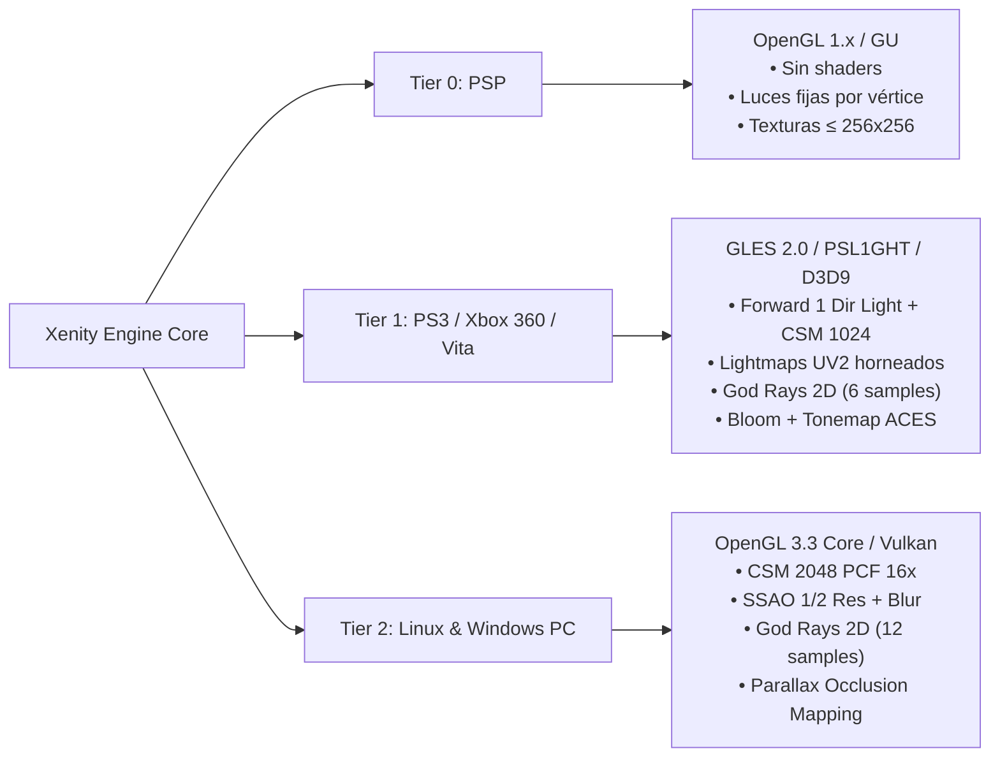

# Plan Maestro de Gráficos: Adaptación de CryEngine 2/3 para Xenity Engine
> **Arquitectura Gráfica Ligera Multiplataforma**: PC (Linux/Windows), PS3, Xbox 360, PS Vita y PSP.
> **Autor**: Xenity Engine Team
> **Fecha**: Noviembre 2026

---

## 1. Filosofía de Diseño: "La Destilación CryEngine"

*Crysis* (CryEngine 2) y *Crysis 2/3* (CryEngine 3) marcaron la cúspide visual de la séptima generación. Sin embargo, su código fuente original era un monolito de millones de líneas diseñado para hardware de PC extremo o adaptado a duras penas en consolas.

**Nuestra estrategia**: Extraer las fórmulas matemáticas, los algoritmos de post-procesado y los trucos ópticos que crearon ese estilo visual fotorrealista (junglas exuberantes, océanos paradisíacos, rayos solares volumétricos y luz atmosférica), implementándolos en **versiones Forward/Hybrid ultra-ligeras** escritas en C++ y GLSL estándar.

---

## 2. Repositorios de Referencia y Fuentes Oficiales

| Proyecto / Fuente | Enlace Oficial | Qué aprender / extraer para Xenity |
| :--- | :--- | :--- |
| **CryEngine Fuente Oficial** | [github.com/CRYTEK/CRYENGINE](https://github.com/CRYTEK/CRYENGINE) | Shaders en `Engine/Shaders/HWScripts/CryFX/`. Fórmulas de niebla y agua. |
| **OpenLara (XProger)** | [github.com/XProger/OpenLara](https://github.com/XProger/OpenLara) | Arquitectura de render multiplataforma en `src/render/` y `src/platform/` (PSP, Vita, PS3, 360, Linux, Win). |
| **Urho3D** | [github.com/urho3d/Urho3D](https://github.com/urho3d/Urho3D) | Shaders GLSL limpios en `bin/CoreData/Shaders/GLSL/` (`LitSolid.glsl`, `PostProcess.glsl`). |
| **Dhewm3 (Doom 3 BFG)** | [github.com/dhewm/dhewm3](https://github.com/dhewm/dhewm3) | Pipeline de 60 FPS en PS3/360: Difuso + Normal + Specular optimizado. |
| **BGFX Graphics Abstraction** | [github.com/bkaradzic/bgfx](https://github.com/bkaradzic/bgfx) | Abstracción de APIs de GPU y ejemplos en `examples/` (sombras CSM, PBR, bloom). |
| **Paper Original de SSAO (Crytek)** | *Screen-Space Ambient Occlusion* (Vladimir Kajalin, 2007) | El paper original publicado por Crytek en ShaderX7 explicando el algoritmo. |
| **Paper de Shading de Epic Games** | *Real Shading in Unreal Engine 4* (Brian Karis, Siggraph) | Aproximación matemática para materiales dieléctricos y metálicos. |

---

## 3. Las 5 Técnicas Icónicas: Algoritmos y Código GLSL

### A. Rayos Solares Crepusculares (Screen-Space God Rays)
CryEngine 2 popularizó los rayos de sol filtrándose entre las hojas de la jungla. En lugar de un costoso raymarching volumétrico 3D, se utiliza un **Radial Blur en 2D** sobre el Framebuffer.

#### Algoritmo:
1. Proyectar la posición 3D del Sol al espacio de pantalla 2D normalizado $[0, 1]$ (`vec2 sunScreenPos`).
2. Generar una textura de oclusión a $1/2$ o $1/4$ de resolución donde el cielo y el sol son blancos ($1.0$) y todos los objetos opacos son negros ($0.0$).
3. Aplicar el siguiente shader de post-proceso:

```glsl
// god_rays.frag - Desenfoque radial desde el sol
#version 330 core
in vec2 TexCoords;
out vec4 FragColor;

uniform sampler2D u_OcclusionTexture; // Textura del sol y siluetas
uniform vec2 u_SunPos;                // Coordenadas [0,1] del sol en pantalla
uniform float u_Density = 0.84;
uniform float u_Weight = 0.58;
uniform float u_Decay = 0.96;
uniform float u_Exposure = 0.25;

const int NUM_SAMPLES = 10; // 6 para PS3/Vita/Xbox 360, 12 para PC

void main() {
    vec2 deltaTexCoord = (TexCoords - u_SunPos) * (1.0 / float(NUM_SAMPLES)) * u_Density;
    vec2 currentCoord = TexCoords;
    vec3 color = vec3(0.0);
    float illuminationDecay = 1.0;

    for (int i = 0; i < NUM_SAMPLES; i++) {
        currentCoord -= deltaTexCoord;
        vec3 sampleColor = texture(u_OcclusionTexture, currentCoord).rgb;
        sampleColor *= illuminationDecay * u_Weight;
        color += sampleColor;
        illuminationDecay *= u_Decay;
    }

    FragColor = vec4(color * u_Exposure, 1.0);
}
```

---

### B. Niebla Atmosférica por Altura (Exponential Height Fog)
Crea la sensación de escala infinita de las islas tropicales de *Crysis*, acumulando niebla en los valles y despejándose en las cumbres montañosas.

```glsl
// Función GLSL para insertar en fragment shaders o post-proceso
vec3 ApplyHeightFog(vec3 surfaceColor, vec3 worldPos, vec3 cameraPos, vec3 sunDir, vec3 fogColor, vec3 sunFogColor) {
    vec3 viewDir = worldPos - cameraPos;
    float dist = length(viewDir);
    viewDir = normalize(viewDir);

    float fogDensity = 0.003;
    float fogHeightFalloff = 0.08;
    float fogHeight = 0.0; // Altura del nivel del mar

    // Integración analítica de la densidad en altura
    float h = worldPos.y - fogHeight;
    float fogAmount = (fogDensity / fogHeightFalloff) * exp(-cameraPos.y * fogHeightFalloff) * (1.0 - exp(-dist * viewDir.y * fogHeightFalloff)) / viewDir.y;
    fogAmount = clamp(1.0 - exp(-fogAmount), 0.0, 1.0);

    // Coloración direccional del sol (In-scattering)
    float sunScattering = max(dot(viewDir, sunDir), 0.0);
    vec3 finalFogColor = mix(fogColor, sunFogColor, pow(sunScattering, 4.0));

    return mix(surfaceColor, finalFogColor, fogAmount);
}
```

---

### C. Océano Tropical con Fresnel de Schlick y Oleaje
El agua de CryEngine combinaba dos capas de normales animadas, desvanecimiento de orilla por profundidad y la fórmula de reflexión de Fresnel.

```glsl
// ocean_water.frag (Forward Rendering)
#version 330 core
in vec3 v_WorldPos;
in vec2 v_TexCoords;
out vec4 FragColor;

uniform sampler2D u_NormalMap1;
uniform sampler2D u_NormalMap2;
uniform samplerCube u_Skybox;
uniform vec3 u_CameraPos;
uniform float u_Time;

void main() {
    vec3 V = normalize(u_CameraPos - v_WorldPos);

    // Animación de oleaje en direcciones opuestas
    vec2 uv1 = v_TexCoords * 4.0 + vec2(u_Time * 0.03, u_Time * 0.02);
    vec2 uv2 = v_TexCoords * 8.0 - vec2(u_Time * 0.02, u_Time * 0.04);

    vec3 n1 = texture(u_NormalMap1, uv1).xyz * 2.0 - 1.0;
    vec3 n2 = texture(u_NormalMap2, uv2).xyz * 2.0 - 1.0;
    vec3 N = normalize(vec3(n1.xy + n2.xy, n1.z));

    // Aproximación de Fresnel de Schlick
    float R0 = 0.02; // Reflactancia para agua pura
    float fresnel = R0 + (1.0 - R0) * pow(clamp(1.0 - dot(V, N), 0.0, 1.0), 5.0);

    // Color del fondo marino tropical vs reflexión del cielo
    vec3 deepWaterColor = vec3(0.01, 0.18, 0.28);
    vec3 skyReflection = texture(u_Skybox, reflect(-V, N)).rgb;

    vec3 waterColor = mix(deepWaterColor, skyReflection, fresnel);
    FragColor = vec4(waterColor, clamp(fresnel + 0.35, 0.0, 1.0));
}
```

---

### D. SSAO Inteligente (Screen-Space Ambient Occlusion)
* **Tier 2 (PC)**: Muestreo de 8 puntos en hemisferio sobre el mapa de profundidad en resolución $1/2$ con desenfoque bilateral posterior.
* **Tier 1 (PS3 / 360 / Vita)**: Baked AO en texturas o en colores de vértices generado en Blender/Assimp (ahorra 4 ms de GPU por cuadro).
* **Tier 0 (PSP)**: Desactivado.

---

### E. Tonemapping ACES y Color Grading (LUT)
Convierte el espacio de color de coma flotante HDR (donde el sol tiene intensidad $10.0$) al espacio visible SDR $[0, 1]$ con una curva cinematográfica idéntica a CryEngine 3.

```glsl
// Curva de Tonemapping ACES (Naughty Dog & Crytek)
vec3 ACESFilm(vec3 x) {
    float a = 2.51;
    float b = 0.03;
    float c = 2.43;
    float d = 0.59;
    float e = 0.14;
    return clamp((x * (a * x + b)) / (x * (c * x + d) + e), 0.0, 1.0);
}
```

---

## 4. Matriz de Compatibilidad Multiplataforma



---

## 5. Hoja de Ruta de Implementación en Xenity

### Fase 1: Base de Post-Procesado HDR (Semana 1)
- [ ] Modificar `Camera::ChangeFrameBufferSize` para inicializar el texture buffer en `GL_RGBA16F`.
- [ ] Implementar `bloom_tonemap.frag` con extracción de luces altas y función `ACESFilm()`.
- [ ] Implementar el shader de `Radial Blur` para God Rays del sol.

### Fase 2: Shaders de Superficie y Mallas (Semana 2)
- [ ] Activar `aiProcess_CalcTangentSpace` en `assimp_mesh_loader.cpp` para generar tangentes y bitangentes.
- [ ] Actualizar `standard_shader.frag` con soporte para Normal Mapping en espacio tangente.
- [ ] Añadir `ApplyHeightFog()` en el fragment shader principal.

### Fase 3: Segundo Canal UV y Lightmaps (Semana 3)
- [ ] Permitir en `mesh_data.h` la carga de `uv2` (segundo canal de coordenadas de textura).
- [ ] Añadir slot `lightmapTexture` en la clase `Material`.
- [ ] Multiplicar $(\text{Albedo} \times \text{Lightmap})$ en el cálculo difuso de áreas estáticas.

### Fase 4: Abstracción de Consolas inspirada en OpenLara (Semana 4)
- [ ] Separar las llamadas dependientes de OpenGL de escritorio en una capa de backend para permitir vincular fácilmente *vitaGL* (PS Vita) o *GCM* (PS3).
