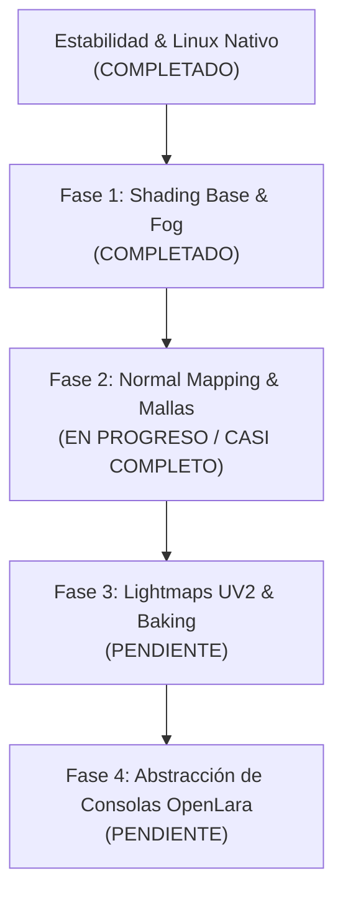

# Estado Actual del Proyecto y Bitácora de Desarrollo (Live Status)
> **Última Actualización**: 21 de Noviembre de 2026  
> **Rama Activa**: `main`  
> **Target Principal**: Linux 64-bit + Multiplataforma (PC, PS3, PS Vita, PSP)

---

## 📍 ¿Dónde Estamos Actualmente? (Resumen Ejecutivo)

El proyecto se encuentra en la **Fase 2 de la Adaptación Gráfica CryEngine**, habiendo completado con éxito la estabilidad nativa en Linux, la eliminación de cuellos de botella en el editor de Rust, y el pipeline de sombreado base (iluminación especular Blinn-Phong, curvas ACES, niebla de altura exponencial analítica y mapeo de normales por cotangentes sin costo extra de VRAM).



---

## 📊 Matriz de Fases y Progreso Detallado

### Fase 0: Soporte Nativo Linux & Corrección de Crashes (100% COMPLETADO)
- [x] Corrección de guards de compilación Windows/MSVC (`vcvars32.bat`, rutas absolutas `C:\...`) en `compiler.cpp`.
- [x] Redirecciones de shell `> /dev/null` en Linux vía macro `DEV_NULL`.
- [x] Eliminación del choque fatal de contextos EGL/GLX (`BadAccess 0x3002`) forzando `wgpu` a Vulkan (`WGPU_BACKEND="vulkan"`).
- [x] Eliminación del lag severo en el viewport requiriendo compilación y ejecución exclusivamente en `--release`.

### Fase 1: Base de Post-Procesado y Sombreado CryEngine (100% COMPLETADO)
- [x] **Alineación de Framebuffer**: `Camera::UpdateFrameBuffer` ahora asigna `GL_RGBA8` nativo para acelerar lecturas por CPU (`glGetTexImage`) hacia Rust sin reconversiones de canal por software.
- [x] **Curva de Tonemapping Fílmico ACES**: Implementada e integrada en `standard.shader` (ajuste analítico de Crytek / Naughty Dog).
- [x] **Modelo Especular Blinn-Phong**: Integrado en el cálculo de luces Direccionales, Spot y Puntuales en `standard.shader`.
- [x] **Niebla Atmosférica por Altura Exponencial (Exponential Height Fog)**: Implementación analítica en `standard.shader`, vinculando uniforms `fogParams` y `fogColor` desde el subsistema `ShaderOpenGL` y `xenity_ffi.cpp`.

### Fase 2: Superficies, Tangentes y Mallas (80% COMPLETADO - ACTIVO)
- [x] **Cálculo de Tangentes y Normales Suaves en Assimp**: Agregadas las banderas `aiProcess_CalcTangentSpace | aiProcess_GenSmoothNormals` en `assimp_mesh_loader.cpp`.
- [x] **Normal Mapping sin Descriptores de Vértice (Cotangent Frame)**: Función `CotangentFrame` integrada en `standard.shader` derivada del paper de Christian Schüler (ShaderX5). Permite relieve fotorrealista con 0 bytes adicionales de memoria en VRAM.
- [ ] **Siguiente Entregable Inmediato**: Implementar shader de `Radial Blur` para Rayos Solares Crepusculares (God Rays) o slot de textura `normalMap` expuesto directamente en el Inspector del Editor de Rust.

### Fase 3: Lightmaps UV2 y Áreas Estáticas (PENDIENTE)
- [ ] Soporte para coordenadas `uv2` en `mesh_data.h` y en el exportador de mallas binarias.
- [ ] Slot `lightmapTexture` en `Material`.
- [ ] Multiplicación $(\text{Albedo} \times \text{Lightmap})$ en el cálculo difuso de geometrías estáticas.

### Fase 4: Abstracción de Consolas estilo OpenLara (PENDIENTE)
- [ ] Modularización del renderizador OpenGL en backends desacoplados (PC GL3.3, PS Vita vitaGL, PS3 PSL1GHT RSX, PSP Sony GU).

---

## 📁 Archivos Modificados Clave en la Sesión Reciente

| Archivo | Qué se modificó |
| :--- | :--- |
| `Xenity_Engine/Source/editor/xenity_ffi.cpp` | Activación de niebla atmosférica y cielo inicial en el FFI del editor. |
| `Xenity_Engine/Source/engine/graphics/camera.cpp` | Formato interno del buffer de color cambiado de `GL_RGB` a `GL_RGBA8`. |
| `Xenity_Engine/Source/engine/graphics/shader/shader_opengl.h` | Declaración de ubicaciones de uniforms `m_fogParamsLocation` y `m_fogColorLocation`. |
| `Xenity_Engine/Source/engine/graphics/shader/shader_opengl.cpp` | Subida de parámetros de niebla por cámara y registro de uniforms. |
| `Xenity_Engine/Source/editor/mesh_loaders/assimp_mesh_loader.cpp` | Flags de importación `aiProcess_CalcTangentSpace` y `aiProcess_GenSmoothNormals`. |
| `Xenity_Engine_Executable/public_engine_assets/shaders/standard.shader` | Integración de Blinn-Phong, ACES Tonemapping, Exponential Height Fog y Cotangent Normal Mapping. |
| `AGENT.md`, `.cursorrules`, `CLAUDE.md` | Protocolo obligatorio de ejecución con `cargo run --release` y consulta de knowledge base. |

---

## ⚡ Comandos Canónicos de Ejecución y Compilación

Todo agente o desarrollador **DEBE** usar exclusivamente estos comandos:

1. **Recompilar el Motor C++ y Biblioteca FFI**:
   ```bash
   cmake --build build -j$(nproc)
   ```
2. **Ejecutar el Editor GUI (OBLIGATORIAMENTE en RELEASE)**:
   ```bash
   cargo run --release --manifest-path xenity-editor/Cargo.toml
   ```
   *(No ejecutar en modo debug sin `--release`; la lectura sin optimizar del framebuffer genera lag).*
