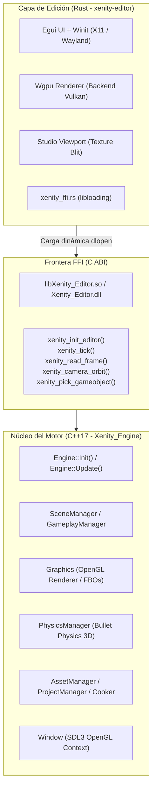

# Arquitectura del Núcleo de Xenity Engine
> **Módulo**: Engine Core & Architecture
> **Autor / Generado por**: Antigravity AI
> **Fecha**: 2026-11-20
> **Estado**: Aprobado / Referencia Activa

---

## 1. Resumen Ejecutivo
Xenity Engine es un motor de videojuegos 3D/2D modular escrito en **C++17** con un editor desacoplado escrito en **Rust (egui + wgpu)**. El motor utiliza **SDL3** para la gestión de ventanas, eventos y controladores, y **OpenGL 3.3 Core** en PC (con soporte para compilación cruzada a consolas retro como PS3, PS Vita y PSP).

---

## 2. Diagrama de la Arquitectura



---

## 3. Ciclo de Vida del Motor (`Engine::Init`)

Cuando el motor se inicia (ya sea como standalone o vía FFI en el editor), sigue un orden de arranque estricto:

1. **`FileSystem::Init()`**: Configuración de rutas relativas y absolutas del proyecto y assets.
2. **`Debug::Init()` & `Profiler::Init()`**: Registro de logs en consola/archivo y contadores de tiempo.
3. **`Renderer::Init()`**: Detección del pipeline de renderizado gráfico.
4. **`Window::Init()`**: 
   - Inicialización de **SDL3** (`SDL_INIT_VIDEO | SDL_INIT_JOYSTICK | SDL_INIT_GAMEPAD | SDL_INIT_EVENTS`).
   - Creación de ventana SDL y contexto OpenGL (`SDL_GL_CreateContext`).
   - Carga de punteros de función mediante **GLAD** (`gladLoadGL`).
5. **`InputSystem::Init()`**: Mapeo de teclas, ratón y gamepads.
6. **`Graphics::Init()`**: Creación de shaders básicos, buffers uniformes y render targets.
7. **`SpriteManager` / `MeshManager` / `AssetManager`**: Cachés de texturas y mallas 3D.
8. **`Time::Init()`**: Inicialización del temporizador de alta resolución (`delta_time`).
9. **`ProjectManager::LoadProject()`**: Carga del proyecto activo (`DefaultProject`) y deserialización de la escena inicial.

---

## 4. Sistema de Componentes y Reflexión (`Reflective`)

* **GameObjects y Transforms**: Todo objeto en la escena es un `GameObject` que posee obligatoriamente un componente `Transform` (posición, rotación en cuaterniones, escala local y matricial).
* **Sistema de Reflexión Propietario (`Reflective`)**:
  - Cada clase que hereda de `Reflective` puede registrar sus variables mediante:
    ```cpp
    Reflective::AddVariable(reflectedVariables, m_speed, "Speed");
    Reflective::AddVariable(reflectedVariables, m_texture, "Texture");
    ```
  - Esto permite serialización automática a JSON / binario `.xenb`, inspección en tiempo real en los paneles del editor y clonación en memoria.

---

## 5. Protocolo de Renderizado en el Editor FFI

Para no incrustar dependencias pesadas de GUI dentro del motor C++, la integración con el editor de Rust funciona mediante un **renderizado desacoplado a Framebuffer (FBO)**:

1. El editor de Rust solicita un frame invocando `xenity_tick()` (el motor avanza físicas, lógica y dibuja el mundo 3D en su framebuffer interno de OpenGL).
2. El editor invoca `xenity_read_frame(buffer_ptr, width, height)`:
   - La textura del FBO se lee con `glGetTexImage` a un búfer compartido.
3. Rust toma esos píxeles y actualiza la textura del Viewport con `egui` sobre **Vulkan**.
